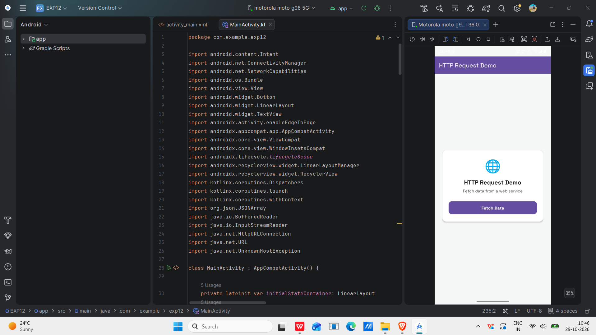
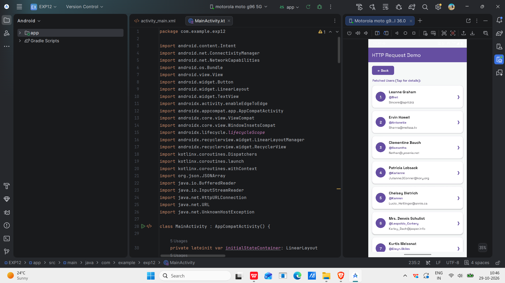
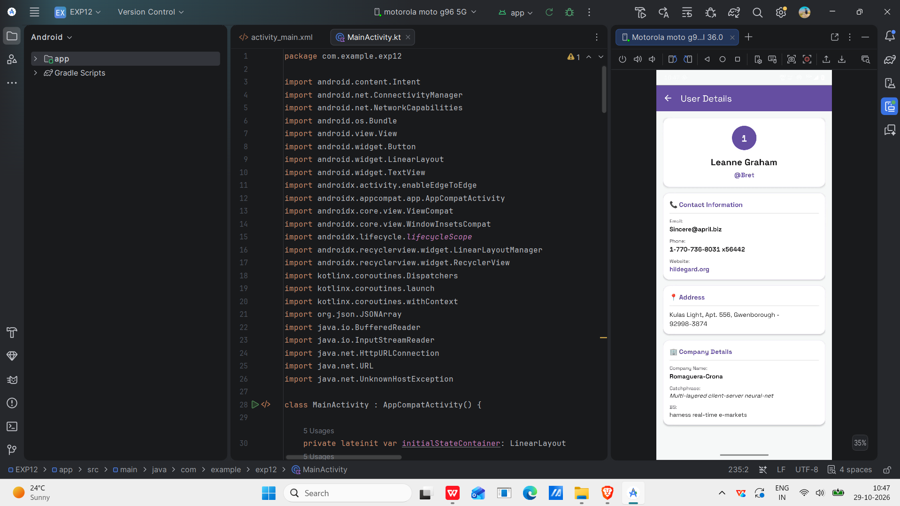
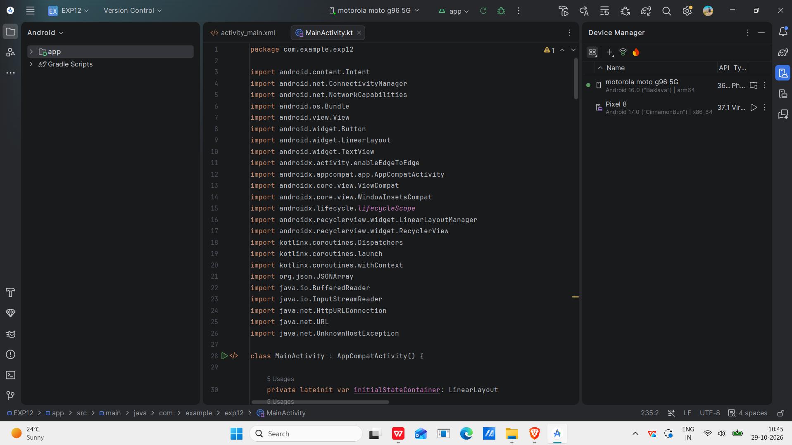

# Experiment 12: Access Web Services Using HTTP Requests in Android

## 1. Aim
To develop an Android application that accesses web services using HTTP GET requests and displays the data received from a server.

## 2. Concept and Technology
HTTP (Hypertext Transfer Protocol) allows an Android application to communicate with a web server. An HTTP GET request retrieves data from a server, and JSON (JavaScript Object Notation) is used to represent the response.

**Technologies used:**
- Android Studio
- Kotlin
- XML
- Android SDK
- HTTP GET request
- JSONPlaceholder REST API

## 3. Scenario
A user wants to retrieve information from an online web service. The application sends an HTTP GET request to a public API, receives user information in JSON format, and displays the results. The user can select a record to view its detailed information.

## 4. API Used
**API URL:** https://jsonplaceholder.typicode.com/users

This is a public testing API. No API key is required.

## 5. Features
- Fetches data from a web service.
- Displays a loading indicator while fetching data.
- Shows a list of fetched users.
- Displays details of a selected user.
- Handles HTTP responses using Kotlin.

## 6. Procedure
1. Create an Android project using Android Studio.
2. Configure the required dependencies.
3. Add internet permission in `AndroidManifest.xml`.
4. Design the user interface using XML.
5. Implement the HTTP GET request in Kotlin.
6. Parse the JSON response.
7. Display the fetched data in the application.
8. Run and test the application on an Android device.

## 7. Screenshots and Output

### Screenshot 1: Initial Screen
The initial screen displays the Fetch Data button.



### Screenshot 2: API Response
The application displays the list of users received from the web service.



### Screenshot 3: User Details
The application displays detailed information about a selected user.



### Screenshot 4: Source Code
The Kotlin implementation used for the HTTP request.



## 8. Test Cases

| Test Case | Test Description | Expected Result |
|---|---|---|
| 1 | Launch the application and tap Fetch Data | User records are fetched and displayed |
| 2 | Select a user from the fetched list | The selected user's details are displayed |
| 3 | Verify the student identification details in the submission | The README and submitted project identify the student |

**Student details for submission:**
- **Name:** Suvendu Mata
- **USN:** 25MCAR0136

## 9. Project Folder Structure

```text
EXP12/
├── app/
│   └── src/
│       └── main/
│           ├── java/com/example/exp12/
│           │   └── MainActivity.kt
│           ├── res/layout/
│           │   └── activity_main.xml
│           └── AndroidManifest.xml
├── Screenshots/
│   ├── HTTPRequestDemo.png
│   ├── APIResponse.png
│   ├── UserDetails.png
│   └── MainActivity.png
├── build.gradle.kts
├── settings.gradle.kts
└── README.md
```

## 10. How to Run
1. Clone or download the repository.
2. Open the project in Android Studio.
3. Wait for Gradle synchronization to complete.
4. Run the app on an Android device or emulator with internet access.
5. Tap Fetch Data to retrieve the user records.

## 11. Result
The Android application sends an HTTP GET request to a public web service, receives JSON data, and displays the fetched user information.

## 12. GitHub Repository
[HTTPRequestDemo Repository](https://github.com/Atiullah18/HTTPRequestDemo)

## Author
**Suvendu Mata**  
Master of Computer Applications (MCA)  
JAIN (Deemed-to-be University), Bengaluru
